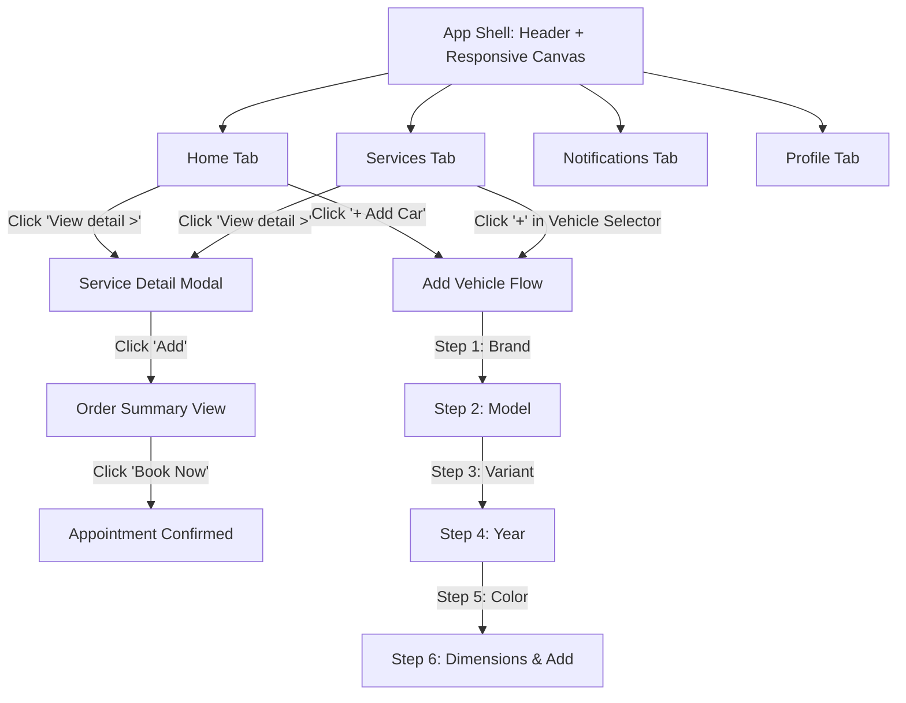

# Bentley Mobile Auto Detail Car Wash Ltd. — Application Architecture & Flow

## 1. Executive Overview
The **Bentley Mobile Auto Detail Car Wash Ltd.** web application has been completely redesigned based on the high-fidelity Figma mobile design system. It delivers a streamlined, mobile-first experience for booking vehicle modifications, detailing, and car wash treatments.

Key UX features:
- **Home Screen**: Blueprint grid hero, headline *"Find your favourite Modifications"*, `+ Add Car` pill, sports car cut-out banner, red contour vehicle selector with live vehicle dropdown, search bar, and "For You" featured modification cards.
- **Services Screen**: Categorized detailing and modifications catalog, search with filter trigger, category pills (`All`, `Exterior Cleaning`, `Interior Cleaning`, `Paint Protection`), and recommended service cards.
- **Service Detail & Order Summary**: Multi-stage modal with service image, pricing, duration, full description, "What's Included" checklist, and one-tap booking confirmation.
- **Add Vehicle Flow**: Multi-step interactive flow (Brand -> Model -> Variant -> Year -> Color -> Dimensions & Capacity).
- **Notifications & Profile**: Dedicated notification drawer and user profile management with saved vehicles and logout.
- **Curved Bottom Navigation**: Signature dark arched bottom bar with active indicator dots and iOS swipe indicator.

---

## 2. Technology Stack
- **Framework & Runtime**: React 19 (`react`, `react-dom`) + Vite 6
- **Language**: TypeScript with strict typing
- **Styling Architecture**: Tailwind CSS v4 (`tailwindcss`, `@tailwindcss/vite`) with centralized CSS custom properties in `src/index.css`
- **Typography & Icons**: Plus Jakarta Sans, Google Material Symbols Outlined, JetBrains Mono
- **Responsive Layout**: Mobile-first architecture centered on tablet/desktop displays (`max-w-md md:max-w-xl mx-auto shadow-2xl`)

---

## 3. Centralized UI System (`src/index.css`)
All colors, box roundness, button geometry, elevation shadows, and typography tokens are defined centrally in `src/index.css` under `:root`:

```css
:root {
  /* Brand Colors from Figma */
  --color-primary: #dc2626;             /* Signature Red (Add Car, Audi outline, Price) */
  --color-primary-hover: #b91c1c;       /* Darker Red on hover */
  --color-primary-light: #fef2f2;       /* Soft red tint */
  --color-primary-border: #fca5a5;      /* Red contour line border */
  --color-primary-glow: rgba(220, 38, 38, 0.25);

  /* Backgrounds & Canvas */
  --bg-app: #ffffff;                    /* Pure white app canvas */
  --bg-canvas: #eceff3;                 /* Tablet/Desktop outer viewport */
  --surface-card: #ffffff;              /* Crisp white cards */
  --surface-alt: #f1f3f5;               /* Pill, chip & button backgrounds */
  --surface-dark-nav: #1e1e22;          /* Curved bottom navigation bar */

  /* Typography Colors */
  --text-main: #111418;                 /* Primary bold headings & titles */
  --text-muted: #71717a;                /* Subtitles, "Starting at", descriptions */
  --text-light: #a1a1aa;                /* Placeholders & timestamps */

  /* Roundness Tokens */
  --radius-box: 18px;                   /* Standard service & vehicle cards */
  --radius-btn: 12px;                   /* Action buttons */
  --radius-pill: 9999px;                /* + Add Car, Audi selector, Category pills */
  --radius-input: 12px;                 /* Search and form inputs */
}
```

### Shared UI Utilities:
- `.bg-grid-blueprint`: Architectural blueprint grid pattern in the hero section.
- `.vehicle-selector-contour`: Red contour line bridging the vehicle selector pill across the screen width.
- `.curved-bottom-nav`: Dark curved arched navigation bar (`border-top-left-radius: 32px; border-top-right-radius: 32px`).
- `.btn-figma-primary`: Red action button with micro-scaling interactions.
- `.btn-figma-subtle`: Gray button used for `View detail >`.

---

## 4. Current Directory Structure
```
bentleymobilecarwash/
├── img/                             # Figma source designs and reference exports
├── public/
│   ├── favicon.png                  # Mascot brand favicon
│   └── favicon.svg                  # Vector SVG favicon
├── src/
│   ├── assets/
│   │   ├── Logo_Bentley.png         # Bentley mascot logo
│   │   ├── hero-sports-car.png      # Modified pearlescent sports car cutout
│   │   └── bentley-mobile-logo.svg  # High-definition vector SVG logo
│   ├── components/
│   │   ├── Header.tsx               # Top header with iOS status bar, Bentley logo & profile avatar
│   │   ├── BottomNav.tsx            # Curved dark navigation bar with active dot indicators
│   │   └── tabs/
│   │       ├── HomeTab.tsx          # Figma Home screen with blueprint hero, vehicle selector & For You
│   │       ├── ServicesTab.tsx      # Figma Services screen with vehicle selector, filters & catalog
│   │       ├── ServiceDetailModal.tsx # Full-screen detail & Order Summary modal
│   │       ├── AddVehicleModal.tsx  # Multi-step vehicle registration flow (Brand -> Capacity)
│   │       ├── NotificationsTab.tsx # Notifications screen
│   │       └── ProfileTab.tsx       # User profile screen with quotes, saved vehicles & logout
│   ├── data/
│   │   └── mockData.ts              # Services catalog, user info, saved vehicles, and vehicle databases
│   ├── types/
│   │   └── index.ts                 # TypeScript interfaces for services, vehicles, and tabs
│   ├── App.tsx                      # Root component orchestrating navigation and modals
│   ├── index.css                    # Centralized design tokens and utility classes
│   └── main.tsx                     # Mount point
├── app_architecture_and_flow.md     # Updated system architecture documentation
├── package.json                     # Scripts and dependencies
└── vite.config.ts                   # Vite 6 configuration
```

---

## 5. Screen Breakdown & User Flows



---

## 6. Verification
- `npm run build` (`tsc -b && vite build`) passes with zero errors.
- Visual layout, typography, colors, and interactive flows verified via browser testing.
